# Using Zero2Dev

A step-by-step guide for 0.0.1. Zero2Dev is one program: start it, and the control panel opens in your browser at `http://127.0.0.1:7000`.

> The screenshots were taken on a Linux test machine, so paths look like `/tmp/...`. On Windows you will see paths such as `C:\work\my-app`. Everything else is identical.

Contents: [1. Start](#1-start-zero2dev) · [2. Install Caddy](#2-install-a-runtime-caddy-node-go) · [3. Run an app](#3-run-an-app-as-a-service) · [4. Give it a local domain](#4-give-it-a-local-domain-sites) · [Databases and editors](#databases-code-editors-and-database-tools) · [5. Logs](#5-watch-the-logs) · [6. Settings](#6-settings) · [7. Portable data](#7-your-data-moving-backing-up-resetting) · [8. Troubleshooting](#8-troubleshooting)

---

## 1. Start Zero2Dev

1. Put `zero2dev.exe` in a folder you own, for example `D:\zero2dev\`. (Download it from the GitHub release, or build it with `build.ps1`.)
2. Double-click it. No window opens: Zero2Dev starts in the background, puts its icon in the notification area (next to the clock) and opens your browser at a link like `http://127.0.0.1:7000/#token=...`. The token is your password; the page saves it and removes it from the address bar.
3. The first run creates a `data` folder next to the exe. Messages go to `data\logs\zero2dev.log` (started from PowerShell, `.\zero2dev.exe` prints them in the terminal instead).

**Getting back to it and stopping it.**

| To | Do |
| --- | --- |
| Open the dashboard again | Click the Zero2Dev icon in the notification area, or double-click `zero2dev.exe` again (a second start just opens the dashboard of the one already running) |
| Open the data folder | Right-click the icon > **Open data folder** |
| Quit | Right-click the icon > **Quit Zero2Dev**, or **Quit Zero2Dev** at the bottom of the sidebar. Your running services are stopped cleanly first (the dialog lists them) |

If Zero2Dev cannot start (another program uses its port, or the data folder is damaged), a message box says why.

**If your browser shows this page instead**, it has no token yet. Open the link again from the tray icon, or paste the token from `data\token`:

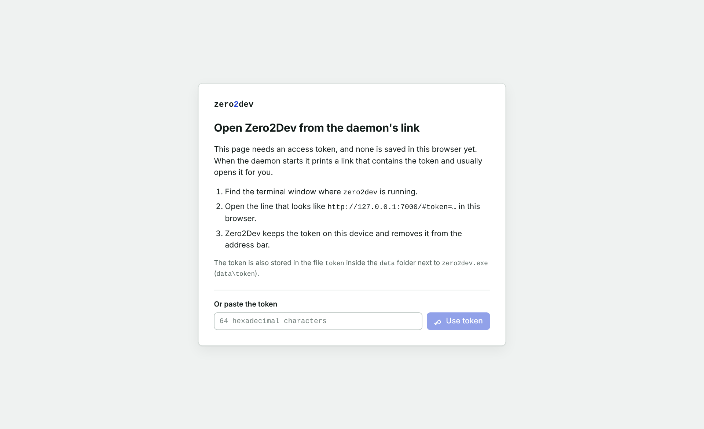

You land on the **Dashboard**:
- **On a fresh install:** a welcome card with a one-minute tour, and the **Get started** checklist. Each step has **Show me**, which starts the matching tutorial.
- **Later, the state of everything at a glance:**
  - A status line, such as "2 of 3 services running · sites served by Caddy (running)".
  - Four tiles: Services, Sites, Runtimes and Databases. Each opens its page, already filtered.
  - A live card per service, with its uptime, latest output line, Start, Stop and Restart, and links to its logs and address. **Start all** and **Stop all** are above the cards.
  - Your sites, each with an on/off switch.
  - **Recent activity**: the latest output across all services.

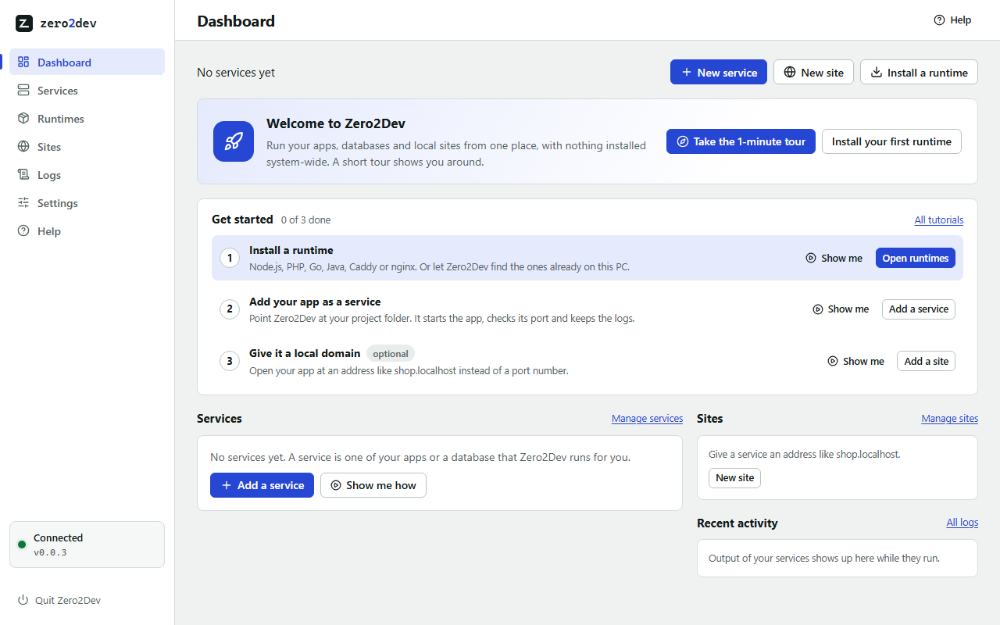

The left menu has **Dashboard**, **Services**, **Runtimes**, **Sites**, **Logs**, **Settings** and **Help**.

**Help** has interactive tutorials:
- The tutorials are **Install a runtime**, **Create a service**, **Give it a local domain**, **Add a database**, **Open a project in your editor** and **A quick look around**.
- Starting one opens a small guide next to what to press, with an arrow pointing at it and the rest of the page dimmed (you can still click anywhere). It takes you to the right page and moves on by itself when it sees the step happen (the runtime finished installing, the service runs).
- **Back**, **Skip** and the × always work. A reload continues where you were.

The Help page also explains how runtimes, services, sites and the data folder fit together, and has fixes for the usual problems. The green *Connected* box at the bottom left means the page is talking to the program.

---

## 2. Install a runtime (Caddy, Node, Go)

A *runtime* is a program Zero2Dev can run for you. **Caddy** is the web server that gives your apps local domains; Node and Go run your code.

1. Open **Runtimes**. **List** and **Grid** (top right) switch between rows and tiles; the choice is remembered. In the grid, a tile's **Manage** or **Install…** opens its details in a dialog. In the list, every runtime is one row: its name, what it is, the versions you have (the default is marked *default*) and one button. Use the filters at the top (**All**, **Installed**, **Languages**, **Web servers**, **Databases**, **Code editors**, **Database tools**) to shorten the list.
2. Press **Install…** on the **Caddy** row. The row opens with the newest version already picked and a line on how the download is checked; press **Install**.
3. Zero2Dev downloads it, checks the download against the published checksum, and unpacks it into the `bin` folder next to `zero2dev.exe`. While it works, the row shows the progress, even when you close it. When it finishes, the version appears in the row and a **Caddy** service is created for you.

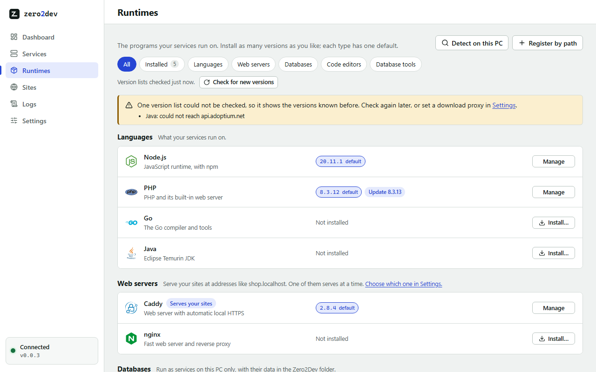

Other ways to get a runtime:

| Button | Use it when |
| --- | --- |
| **Detect on this PC** | A program is already installed. Zero2Dev lists what it finds on your PATH; press **Register** on a line, or **Register all**. Registering only remembers the path. |
| **Register by path** | The program lives somewhere unusual, e.g. `C:\php\php.exe`. |
| **Import it** (in an open row, under the version list) | Downloads are blocked on your network. Save the archive in your browser, then import it. Zero2Dev still verifies it. |

Nothing is installed system-wide: runtimes stay in the `bin` folder next to `zero2dev.exe`, and you can delete one by removing it from the list.

### Install runtimes and keep several versions side by side

Every runtime has its own row on the **Runtimes** page; **Manage** opens it. You can install **as many versions as you like at the same time**, for example PHP 7.1 for an old project and PHP 8.4 for a new one.

1. Open **Runtimes**. Press **Check for new versions** to ask the publishers (nodejs.org, go.dev, GitHub for Caddy, windows.php.net, Adoptium, nginx.org) which versions exist. It tells you how many new ones it found. A site that cannot be reached is named in a notice; that runtime keeps the versions known before, and the others still work. The page asks once automatically the first time.
2. In an open row, pick a version from the list and press **Install**. Tags: *latest* (newest of that version line), *LTS* / *stable* / *mainline*, *installed*, *unverified*.

   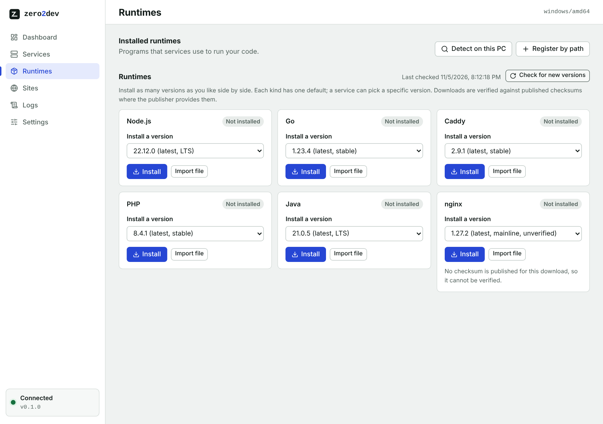

3. **Some downloads cannot be verified.** nginx.org publishes no checksum, and some old PHP releases (7.x) have none either. Zero2Dev tells you and asks you to confirm. It still downloads over HTTPS from the publisher only, and writes the SHA-256 it computed to `data\logs\installer.log`. If you have a SHA-256 you trust, use **Import file** and paste it instead; then it is verified like everything else.

   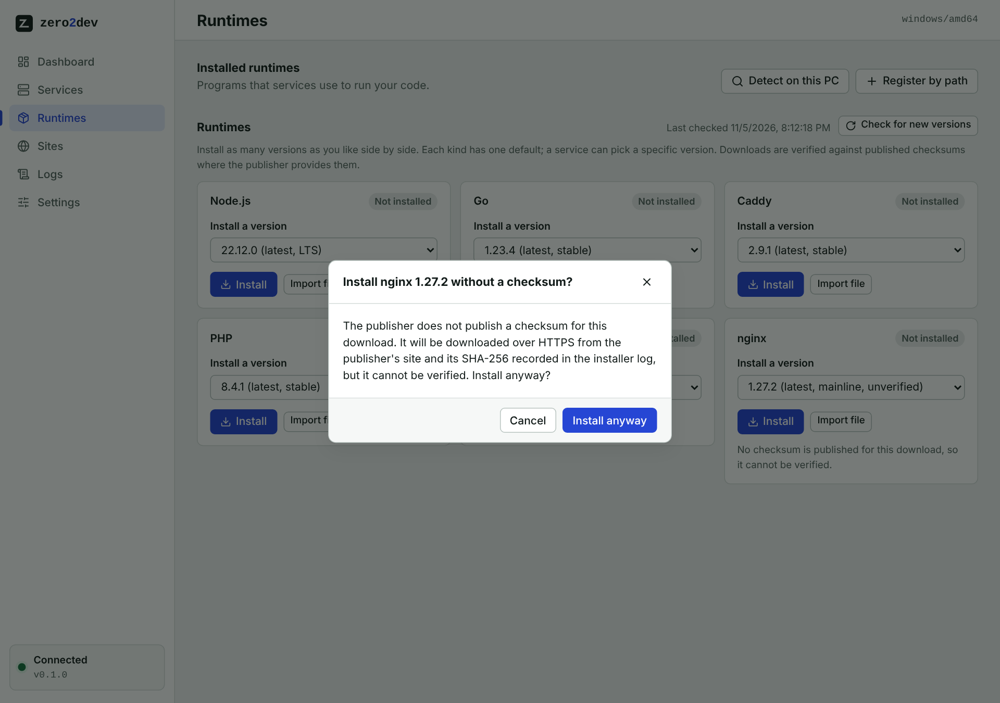

   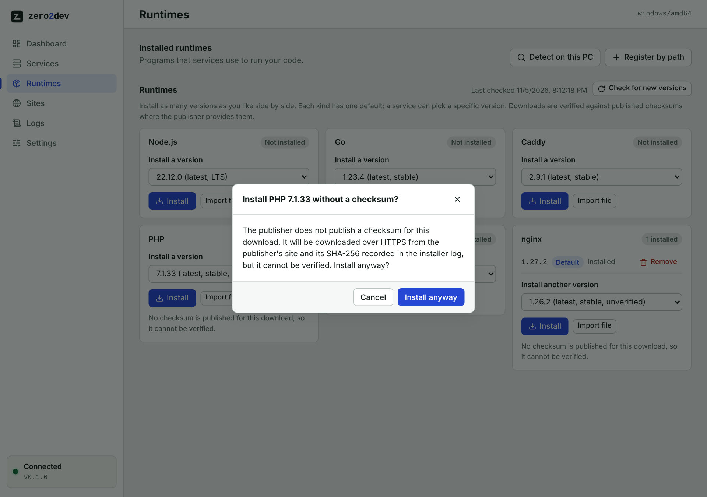

4. Install a second version the same way. Both appear in the row. A newer version of a line you have shows as **Update** in the row, with **Select** to pick it. The first version you install becomes the **Default**; press **Make default** on another one to change it. **Remove** deletes one version only; if you remove the default, another installed version becomes the default.

   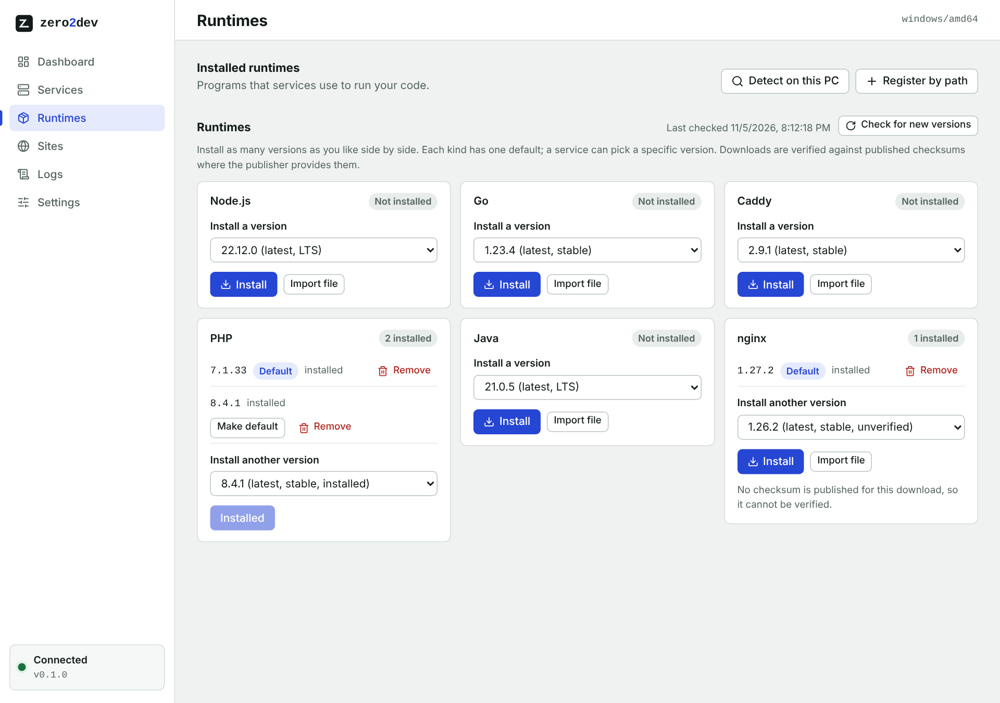

   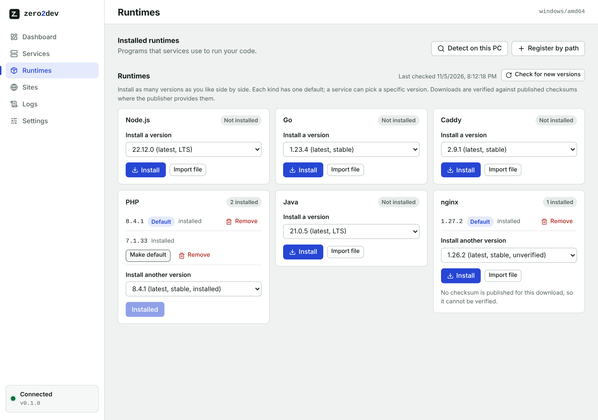

5. **Choose a version per project.** In a service's form, the **Version** list shows every installed version of that type. Leave it on *Default (...)* to follow the default, or pick e.g. *PHP 7.1.33* for that service only. Another service can use PHP 8.4.1 at the same time.

Good to know:
- **Removing a version in use** is refused while a service picked that exact version; the message names the service.
- **Windows only** for nginx and PHP (the publishers provide no Linux builds). Java (Eclipse Temurin) is available on Windows and Linux.
- **PHP needs the Microsoft Visual C++ Redistributable** (x64) installed on Windows. If `php.exe` will not start, install it from Microsoft.
- **nginx settings live inside the nginx folder** (`bin\nginx-<version>\conf`). Every nginx version has its own folder, so keep your own configuration in a folder of your own and pass it to the service with `-p` and `-c` arguments.
- Runtimes you added with **Register by path** are never touched by installs or removals (Forget only removes them from the list).

---

## 3. Run an app as a service

A *service* is a command Zero2Dev starts, stops and watches for you, with its output in one place.

1. Open **Services** and click **New service**. The editor opens as its own page.
2. **What do you want to run?** Pick a card: Node.js, PHP, Go, Java, a database (MariaDB, MySQL, PostgreSQL, Redis), or *Custom command* for any other program. Each card says in one line what the type is. Caddy and nginx are not offered: Zero2Dev creates their services itself when you install them. The type then shows at the top of the form with a **Change type** button.
3. Fill in the form. It only asks for what the chosen type uses:

   | Part | What to enter |
   | --- | --- |
   | **Name** | Anything, e.g. `My API` |
   | **Project folder** | Your app's **code**, e.g. `C:\work\my-api`. Zero2Dev starts the program in this folder; it never stores its own data there. Click **Browse...** to pick it in the Windows folder dialog, or type the path. Databases have no project folder: their form shows the **data folder** Zero2Dev keeps their files in instead. For *Custom command* it is called **Working folder** |
   | **Program** | Only for *Custom command*: the program to run, e.g. `python` |
   | **Port** | The port your app listens on (your app also gets it as `PORT`). Databases and PHP start with their usual port |
   | **Version** | Which installed version to use. Leave on *Default (...)* to follow the default of that type |
   | **Start automatically when Zero2Dev starts** | A switch |
   | **Settings** | The few settings most people change for this type, already set to values that work. **More settings (n)** shows the rest, grouped. Each setting says what it does and ends with what it writes (e.g. `--max-connections`, `php.ini memory_limit`). A changed setting is marked **Edited** with a **Reset** link, and it always stays visible, even when its group is folded. See [Settings by type](#settings-by-type) |
   | **Advanced** | Rarely needed: **arguments for your app** (added after the generated ones), a **Health check path** such as `/health` where the type has one, **Environment variables** (yours win over the settings), and **Write my own command line** |

   Beside the form, **What will run** stays in view while you scroll:
   - the exact command line (with **Copy**);
   - the variables Zero2Dev adds;
   - the files it writes before each start (PHP's php.ini);
   - what is still missing ("Fill in Script to complete the command line") or wrong ("No MariaDB is installed yet");
   - how many settings differ from the defaults, with **Reset all**;
   - **Always added**: the arguments Zero2Dev always adds, each with the reason (e.g. `--bind-address=127.0.0.1`: only this PC can connect).

   On a narrow window the panel moves below the form, and **Create service** stays pinned at the bottom.

   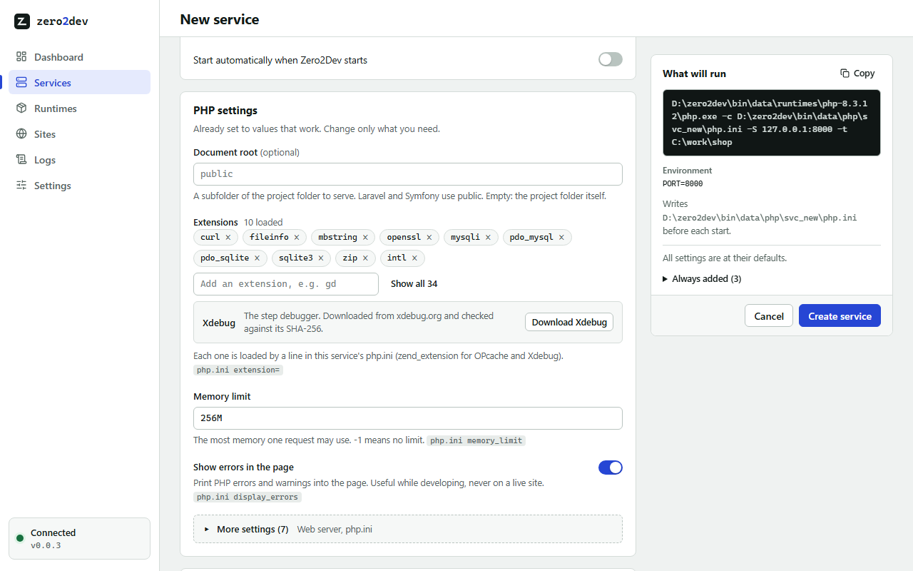

4. Click **Create service**. It appears in the list, stopped:

   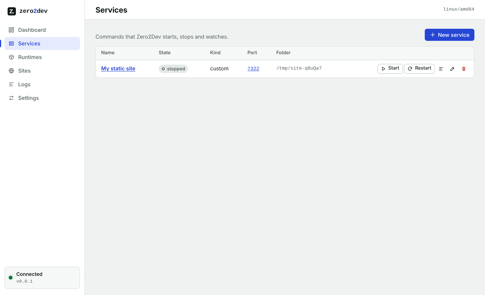

5. Click **Start**. The state changes to *starting*, then *running* once the port answers. While it runs you get **Stop** and **Restart**. Stopping a service stops the whole process tree.

Typical examples:

- **Node app**: Type *Node.js*, Script `server.js` (or Run: *An npm script*, `dev`), Project folder = your project.
- **PHP**: Type *PHP*, Project folder = your site, Document root `public` for Laravel or Symfony. Tick the extensions you need.
- **Go app**: Type *Go*. Package `.` runs `go run .` in your project; `./cmd/api` runs a subfolder.
- **A database**: Type *MariaDB*, *MySQL*, *PostgreSQL* or *Redis*. Nothing else is needed.
- **Anything else**: Type *Custom command*, Program = the program, Arguments = its options.

Click a service's name to open its page: **Edit** opens the same editor, and Cancel or Save brings you back. The page shows the exact command it runs (e.g. `node.exe server.js --port 3000`), folder, process id, start time, address and live output.

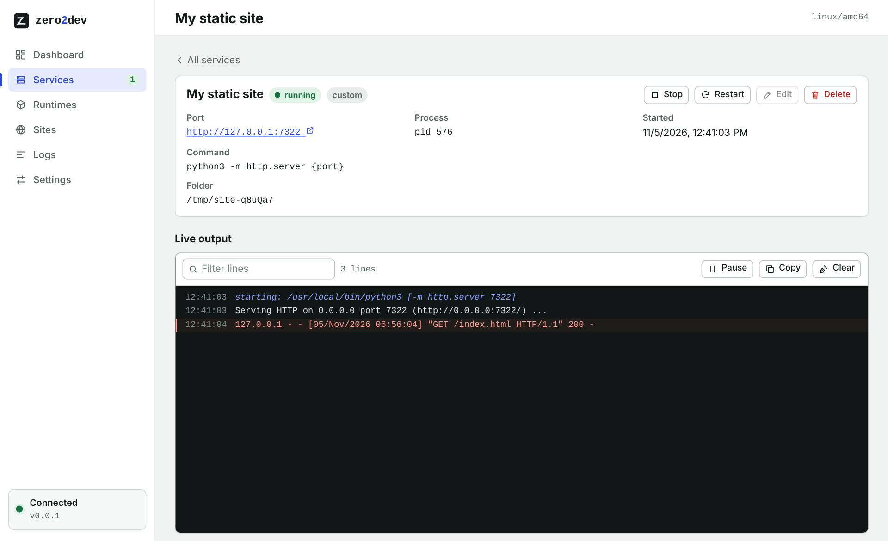

---

### Settings by type

| Type | Settings (defaults in brackets) | Kept in the data folder |
| --- | --- | --- |
| Node.js | Run a **script** or an **npm script** (names from your package.json are suggested); **Restart when a file changes** `--watch` (Node 18.11+); **.env file** `--env-file` (Node 20.6+); **debugger** `--inspect` [9229]; **NODE_ENV** [development] | npm's download cache: `data\node\npm-cache` |
| PHP | **Document root**; **Router script**; php.ini **start from** development or production; **Extensions** (tick boxes for everything in that PHP's `ext` folder) [curl, fileinfo, mbstring, openssl, mysqli, pdo_mysql, pdo_sqlite, sqlite3, zip, intl]; **memory_limit** [256M], **upload_max_filesize** / **post_max_size** [64M], **max_execution_time** [60], **display_errors** [on], **date.timezone** [UTC]; **More php.ini lines**; **Xdebug** mode, start and editor port [9003] | The service's own `php.ini`, sessions, uploads and Xdebug output: `data\php\<service id>` |
| Go | **Package** [.]; **Build tags**; **Keep Go's downloads and build cache in the data folder** [on] | `data\go` (GOPATH, GOCACHE, GOENV) |
| Java | Run a **JAR** or a **main class** with a class path; **Max memory** `-Xmx`; **Pass the port as server.port** (Spring Boot); **debugger** [5005] | none |
| MariaDB, MySQL | **Character set** [utf8mb4], **Collation**, **SQL mode** (server default, strict, permissive for old apps), **Max connections** [151], **InnoDB buffer pool** [128M], **Max packet size** [64M], **Log every query**, **Log slow queries** [after 2 s] | The database files: `data\mariadb\<service id>`, `data\mysql\...` |
| PostgreSQL | **Max connections** [100], **Shared buffers** [128MB], **Log statements** [none], **Log statements slower than** [off], **Time zone** | `data\postgres\<service id>` |
| Redis | **Keep the data**: snapshots (Redis default), after every write, or not at all; **Memory limit** and what to do **when the limit is reached**; **Databases** [16] | `data\redis\<service id>` |

**PHP extensions and Xdebug.** The loaded extensions show as chips: remove one with its ×, add one by typing its name in **Add an extension**, or open the full tick-box list with **Show all**. The list is read from the selected PHP version's `ext` folder, so it always matches that version. Zero2Dev writes the service's own php.ini on every start (in its data folder) from the version's `php.ini-development` or `php.ini-production` plus your settings; PHP's own folder is never changed. The **Xdebug** row below the extensions shows whether that version has it. When it has none, **Download Xdebug** fetches the matching build from xdebug.org, checks it against the SHA-256 xdebug.org lists, and puts it into that version's `ext` folder (it is program code, so it goes to `bin`). It is loaded right after the download (the row then has a **Load it** switch), and its settings appear. Xdebug downloads are for PHP 8.0 and newer.

**Your own command line.** Under **Advanced**, **Write my own command line** turns the settings off and lets you write every argument yourself, starting from the generated ones. Services created before 0.0.3 that had arguments open this way and keep running exactly as before; their page offers **use the settings instead**, which shows the new command line before switching.

---

## 4. Give it a local domain (Sites)

A *site* maps a name like `demo.localhost` to a folder (a static website) or to a running service. Caddy does the work, so **install Caddy first** (step 2).

1. Open **Sites** and click **New site**.
2. Fill in:
   - **Name**: a label for you. The domain is filled in from it (`My Shop` becomes `my-shop.localhost`) until you edit the domain yourself.
   - **Domain**: lowercase, ending in `.localhost`, e.g. `demo.localhost`.
   - **Points to**: *A service* (one of your services; the site follows its port), *A port* (an app you start yourself), or *A folder* (static files served as they are).
   - **Use HTTPS instead of HTTP** if you want `https://` (see [Settings](#6-settings)).

   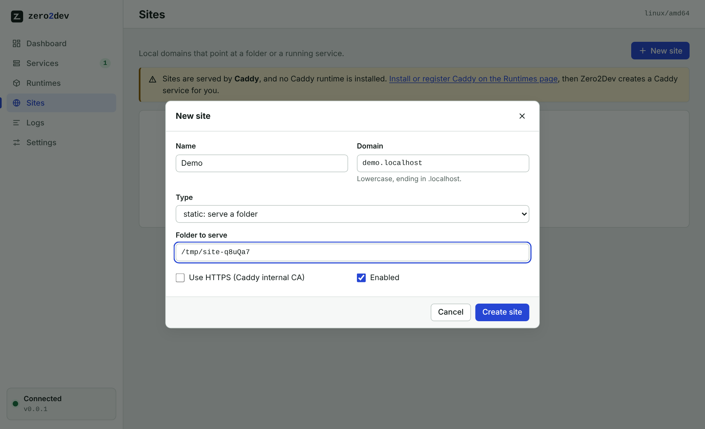

3. Click **Create site**. It is listed as *enabled* with its address:

   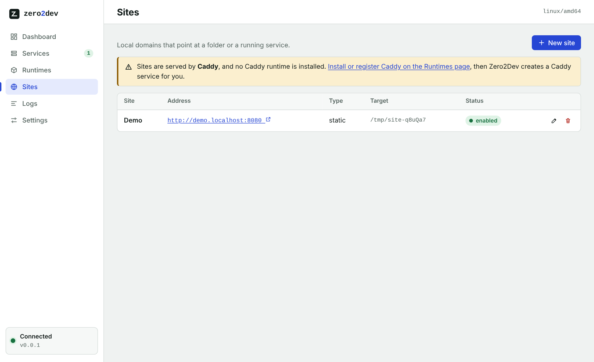

4. Go to **Services** and **Start** the **Caddy** service (created when you installed Caddy).
5. Open `http://demo.localhost:8080` in your browser (HTTPS sites use port `8443`).

Browsers resolve `*.localhost` to your own computer, so no hosts-file edit and no administrator rights are needed. Edits to sites are applied to Caddy automatically.

To take a site offline without deleting it, click **Disable** in its row; **Enable** brings it back. It works like Stop and Start for services.

**Prefer nginx?** Install nginx on the **Runtimes** page, then pick **nginx** under **Settings > Site server** and save. Zero2Dev creates an **Nginx (sites)** service, stops Caddy if it was running and starts nginx in its place. Sites, domains and ports stay the same. nginx only listens on `127.0.0.1`.

---

## Databases, code editors and database tools

### A database

1. On **Runtimes**, install a database from the **Databases** group: **MariaDB**, **MySQL**, **PostgreSQL** or **Redis**.
   - MariaDB, Redis and the editors are checked against a SHA-256.
   - MySQL is checked against the MD5 it publishes.
   - PostgreSQL publishes no checksum, so you confirm first, as with nginx.
2. On **Services**, click **New service** and pick the database as the **Type**. The usual port is filled in (3306, 5432 or 6379). Pick a free one if another database already uses it.
3. Click **Start**. The first start creates the database files, which takes a few seconds; the log shows each step.
4. The service page shows **Connection**: host `127.0.0.1`, the port, the user (`root` for MariaDB/MySQL, `postgres` for PostgreSQL) and a URL to copy. There is no password, so the server only accepts connections from this PC.

Good to know:
- **Where the data lives:** `data\<database>\<service id>`, for example `data\postgres\svc_1a2b3c4d`. It moves with the Zero2Dev folder, and deleting the service keeps it, so delete that folder yourself when you no longer need it.
- **Stopping:** **Stop** asks the server to shut down cleanly (`mysqladmin shutdown`, `pg_ctl stop`, `redis-cli shutdown`) and only ends it if it does not stop within 20 seconds.
- **Run Zero2Dev without administrator rights.** PostgreSQL refuses to start from an administrator account.
- **Custom arguments:** if you set your own **Arguments**, Zero2Dev does not create or manage the data folder for you.

### Code editors and database tools

- Install **VS Code**, **VSCodium** or **Notepad++** from **Code editors**. Their settings and extensions go to `data\code` and `data\codium` (Notepad++: `data\notepadpp`), not into `bin`, which only holds the programs.
- Each installed editor or tool has an **Open** button on its card.
- A service page has **Open in VS Code** (one button per installed editor), which opens the project folder.
- A MariaDB, MySQL or PostgreSQL service page has **Open in HeidiSQL** and **Open in DBeaver** when those are installed. They connect straight to the database. HeidiSQL keeps its settings in `data\heidisql`, DBeaver its workspace in `data\dbeaver\workspace`.
- Programs opened this way are not services: they keep running when Zero2Dev stops.

---

## 5. Watch the logs

- Each service page has **Live output**: type in **Filter lines** to search, **Pause** to stop scrolling, **Copy** to copy the lines, **Clear** to empty the view.
- The **Logs** page shows output from all services in one stream.
- Logs are also saved as files in `data\logs\`, one per service, so they survive a restart.

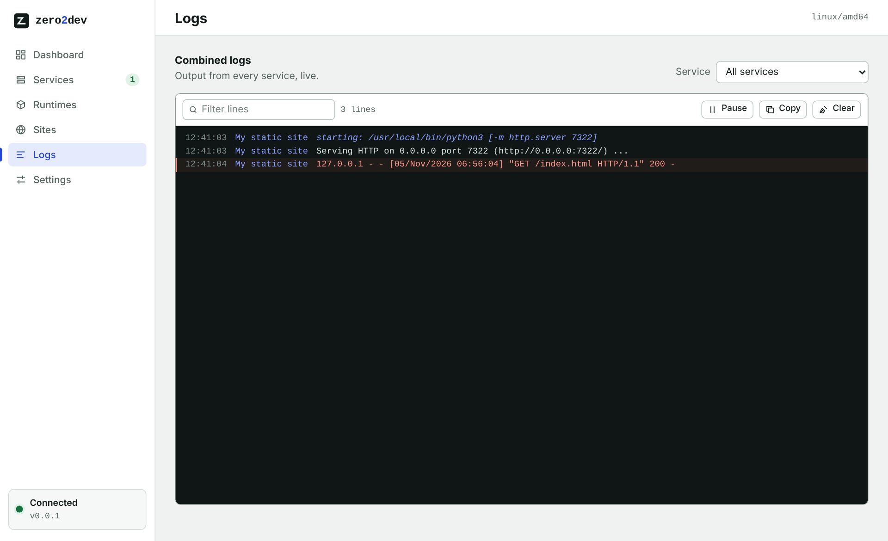

---

## 6. Settings

The Settings page is split into sections, listed on the left (tabs on a narrow window): **Appearance**, **Sites**, **HTTPS**, **Downloads**, **Startup**, **This PC** and **Access**. As soon as you change something, an **Unsaved changes** bar appears at the bottom with **Discard** and **Save settings**; leaving the page with unsaved changes asks first.

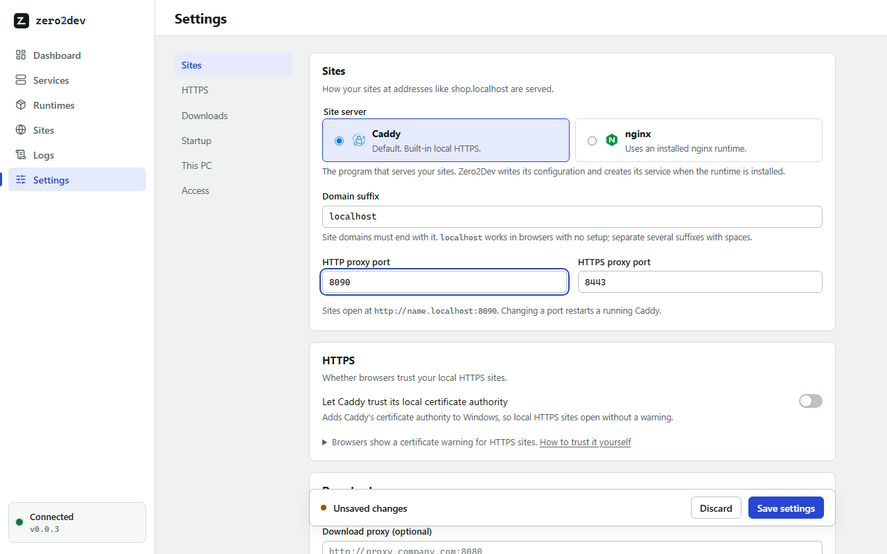

| Section | Setting | What it does |
| --- | --- | --- |
| Appearance | **Theme**, **Accent colour** | How the dashboard looks; saved at once (see below) |
| Sites | **Site server** | **Caddy** (default) or **nginx** serves your sites. Switching stops the running one and starts the other; both use the same ports |
| | **Domain suffix** | The ending your site domains must use. `localhost` works everywhere with no setup |
| | **HTTP / HTTPS proxy port** | Ports the site server listens on (`8080` / `8443`). The line below shows the resulting address. A running Caddy or nginx restarts for you |
| HTTPS | **Let Caddy trust its local certificate authority** | Caddy only. **Off by default**: nothing outside the Zero2Dev folder changes, and browsers warn about `https://` sites; **How to trust it yourself** shows the certificate file to import. Switched on, a notice explains that Caddy will add its certificate to Windows on save (you may get a security prompt). With nginx, Zero2Dev makes its own CA at `data\nginx\certs\ca.crt` |
| Downloads | **Download proxy** | Used when installing runtimes on a company network, e.g. `http://proxy.company.com:8080`. Zero2Dev does not read the Windows proxy setting |
| Startup | **Open this dashboard when Zero2Dev starts** | A switch |
| This PC | | The data folder (with **Copy**), whether the install is portable, the version, the API port and the program folder |
| Access | | **Copy access token**, and **Sign out** of this browser in a separate box |

### Appearance

**Appearance** is the first section of Settings. Changes apply at once and are saved straight away; there is nothing to Save, and the toast that confirms it has **Undo**.

- **Theme**: **System** (follows Windows, and switches when Windows does), **Light** or **Dark**. The sun/moon button in the top bar switches between them from any page.
- **Accent colour**: Blue (the default), Geek blue, Purple, Magenta, Volcano, Orange, Green or Cyan, or **Custom…** for any colour (the colour picker or a `#rrggbb` code). Buttons, links, the selected menu item, switches and progress bars all take the new colour, in light and dark. A preview shows them before you leave the page.
- Very light or bright colours stay readable: Zero2Dev uses a deeper shade or dark text where white text would be hard to read.
- The choice is kept by Zero2Dev itself, so another browser shows the same theme.

The look follows Ant Design; [DESIGN.md](../DESIGN.md) describes it for anyone changing the UI.

---

## 7. Your data: moving, backing up, resetting

Zero2Dev keeps two folders next to `zero2dev.exe`: `data` for your own information and `bin` for the downloaded runtimes.

```
zero2dev.exe
bin\             downloaded programs only, one folder per version (php-8.4.1, node-22.12.0, ...)
data\
  token          your access token
  state.json     your services, runtimes, sites and settings
  caddy\         Caddy's own data (nothing goes to AppData)
  config\        generated Caddyfile and nginx.conf
  nginx\         used by the Nginx (sites) service: logs, temp files, certs (local CA)
  logs\          service logs and installer.log
  mariadb\ mysql\ postgres\ redis\   database files, one folder per service (svc_...)
  code\ codium\  VS Code / VSCodium settings and extensions
  notepadpp\     Notepad++ settings
  heidisql\ dbeaver\   database tool settings and workspace
```

Settings of the editors and database tools never go into `bin`. Only tools Zero2Dev installed use these folders; a program you registered by path keeps its usual settings.

- **Move or copy** the whole folder (exe, `bin` and `data`) to another drive or a USB stick. Stop Zero2Dev first.
- **Back up** by copying `data\` while Zero2Dev is stopped. `bin\` only holds downloads that can be installed again.
- **Reset** by stopping Zero2Dev and deleting `data\` (and `bin\` to remove the runtimes too).
- **Upgrading from 0.0.1**: runtimes you installed before are moved from `data\runtimes` to `bin` the first time 0.0.2 starts.
- **Different location**: set `ZERO2DEV_HOME` to another data folder (runtimes then go to its `bin` subfolder) and, if you like, `ZERO2DEV_BIN` to another runtimes folder.

Keep `data\token` private: anyone who has it can start programs on your computer through Zero2Dev.

---

## 8. Troubleshooting

| Problem | What to do |
| --- | --- |
| A runtime will not install | **Runtimes** → open the failed job → **Show installer log** (also `data\logs\installer.log`). The message names the step that failed |
| Download blocked or very slow | Set a **Download proxy** in Settings, or use **Import file** with an archive you downloaded yourself |
| Windows or antivirus warns about `zero2dev.exe` | The program is not code-signed yet and it downloads and starts programs, which antivirus heuristics dislike. Check the SHA-256 in the release's checksum file, then allow it |
| *Port already in use* | Another program uses that port. Pick a different port in the service or in Settings |
| `demo.localhost:8080` will not open | Check that the **Caddy** service is *running* (Services page) and read its log |
| HTTPS shows a certificate warning | Expected while *Let Caddy trust its local certificate authority* is off. Trust `data\caddy\data\caddy\pki\authorities\local\root.crt` yourself, or turn the setting on |
| The page asks for a token | Open the full `#token=` link from the terminal, or paste `data\token` |
| Service stays *failed* | Open its page: the last error and the live output say why (wrong folder, missing runtime, command not found) |

Environment variables: `ZERO2DEV_HOME` (data folder), `ZERO2DEV_PORT` (panel port, default 7000), `ZERO2DEV_NO_BROWSER` (do not open the browser).
